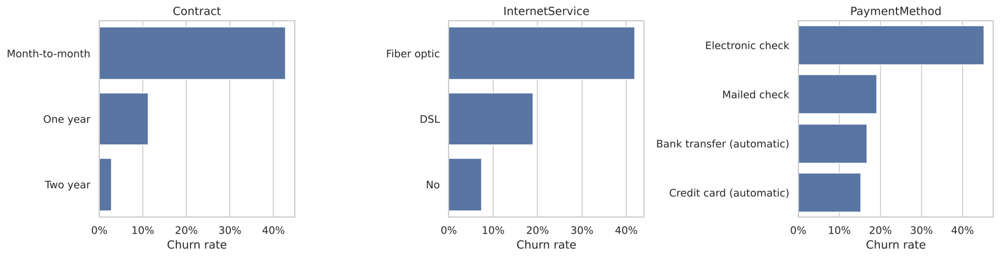
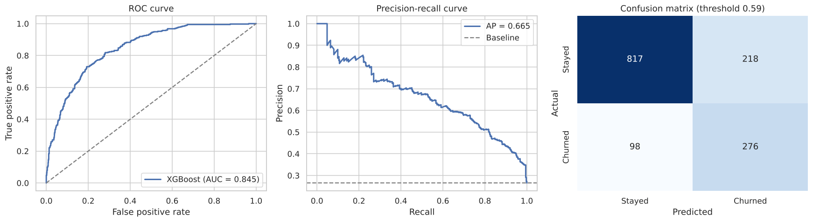
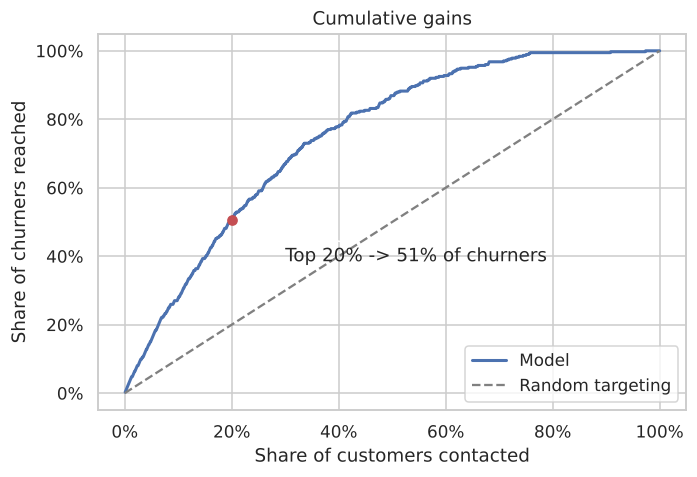
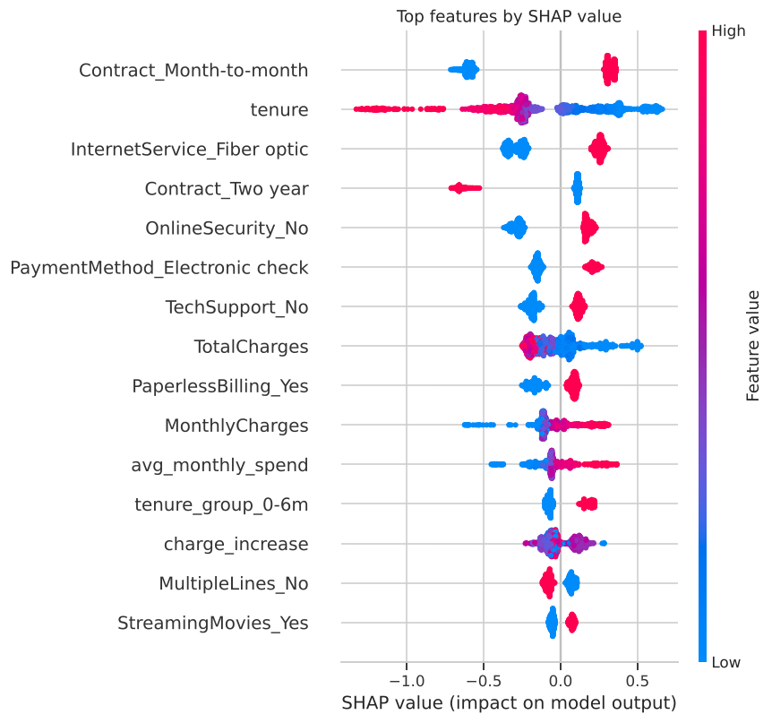

# Telco Customer Churn Prediction

Predicting which telecom customers are about to cancel, and explaining why, so a retention team knows who to call first.



## The problem

About 26.5% of the 7,043 customers in this dataset left. Keeping a customer is much cheaper than finding a new one, but you can't offer every customer a discount. The useful question is: **who is most likely to leave, and what's driving it?**

## What I did

1. **Cleaned the data.** `TotalCharges` was stored as text, with blanks for brand-new customers. Those are filled with 0 rather than an average, because those customers haven't been billed yet.
2. **EDA** on what separates churners from everyone else: contract type, tenure, internet service, add-ons and payment method.
3. **Feature engineering:** number of add-on services, tenure stage, average historical spend, recent price increase, auto-pay flag.
4. **Compared four models** with 5-fold cross-validation: Logistic Regression, Random Forest, XGBoost and LightGBM.
5. **Tuned XGBoost** (randomized search over 40 settings) and **picked the decision threshold** on out-of-fold predictions, so the test set stayed untouched until the end.
6. **Explained the model with SHAP** and built a **cumulative gains chart** to translate the scores into campaign terms.

## Results

| Model (5-fold CV) | ROC-AUC | PR-AUC |
|---|---|---|
| Logistic Regression | 0.847 | 0.660 |
| Random Forest | 0.845 | 0.656 |
| LightGBM | 0.843 | 0.653 |
| XGBoost (default) | 0.840 | 0.651 |
| **XGBoost (tuned)** | **0.850** | – |

**On the held-out test set (1,409 customers):** ROC-AUC **0.845**, PR-AUC 0.665, and recall of **74%** on churners at the chosen threshold.



**For a retention campaign:** contacting the 20% of customers with the highest scores reaches **51% of everyone who would churn**, and the top 30% reaches **67%**.



## What drives churn



- **Month-to-month contracts.** 43% of these customers churn, vs 3% on two-year contracts. This is the biggest factor.
- **The first year.** Churn among customers in their first 12 months is 47%, vs 17% after that.
- **Fiber optic customers** churn at 42%, more than double DSL. That points to price or service quality.
- **No online security or tech support.** These customers churn at ~42%, vs ~15% for those who have it.
- **Electronic check payers** churn at 45%, vs 15-17% on automatic payments.

**Suggested actions:** incentives for switching to annual contracts, bundling security/support into fiber plans for new customers, and pushing auto-pay.

## Run it

```bash
pip install -r requirements.txt
jupyter notebook churn_analysis.ipynb
```

The tuned pipeline and threshold are saved to `models/churn_model.joblib`, and all metrics to `results/metrics.json`.

## Data

[IBM Telco Customer Churn](https://github.com/IBM/telco-customer-churn-on-icp4d) sample dataset, included in `data/`.

## What I'd do next

- A cost-based threshold once real retention offer costs are known
- Survival analysis to predict *when* a customer will leave, not just *if*
- Calibration checks before using the scores as probabilities
